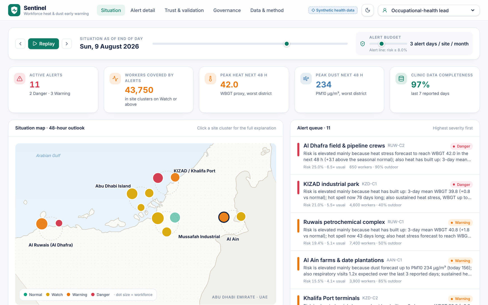
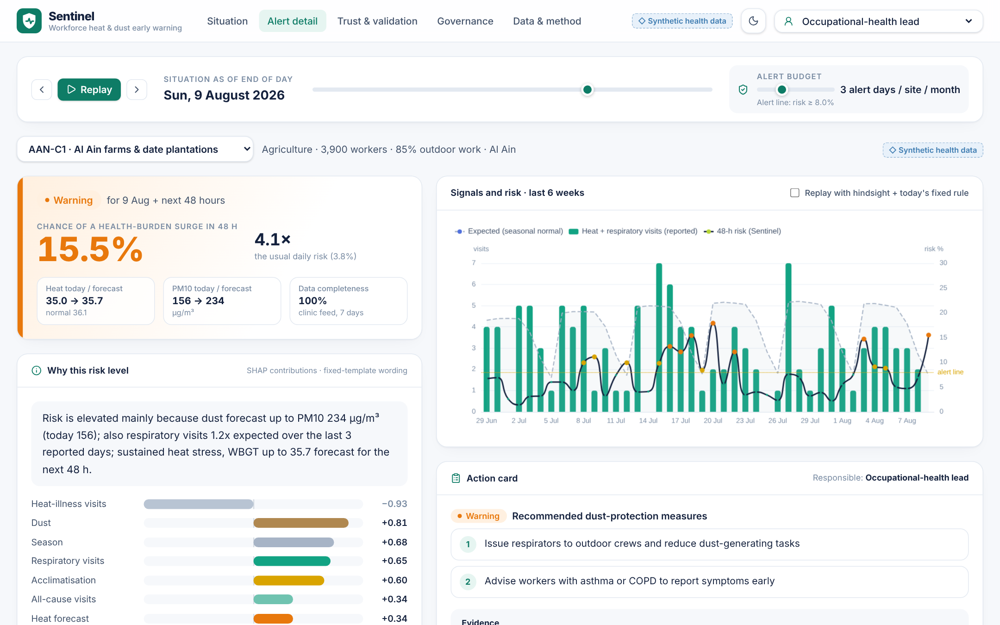
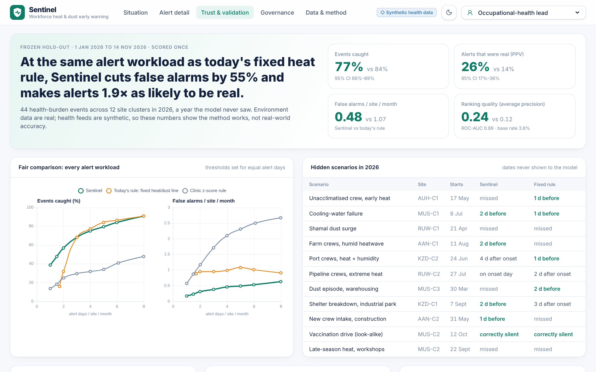
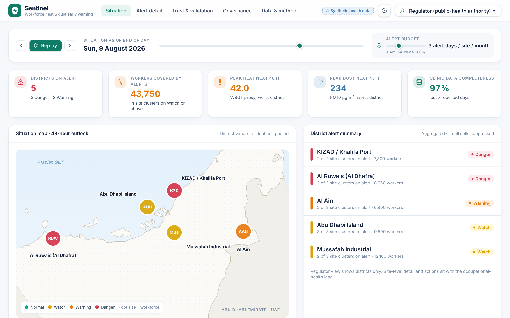
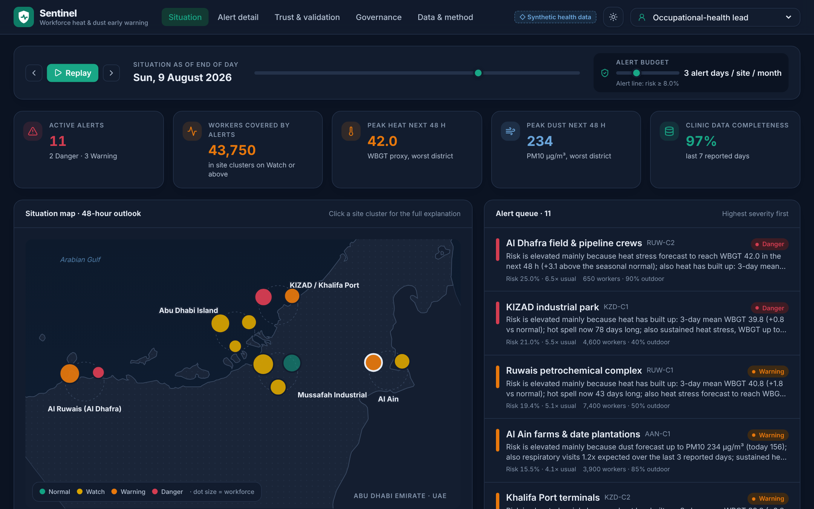
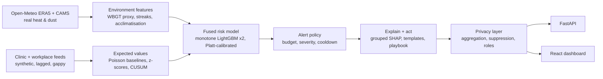

<div align="center">

# Sentinel

### Explainable 48-hour early warning for heat and dust health risk in outdoor and industrial workforces

**Future Health Digital Innovation Challenge 2026** · Population Health · *Population and Workforce Health Early Warning*

[**Live prototype**](https://devrisny.github.io/Sentinel-Health-Early-Warning/) · [**Demo video (3 min)**](docs/Sentinel_Demo_Video.mp4) · [Technical documentation](docs/TECHNICAL_DOCUMENTATION.md) ([PDF](docs/Sentinel_Technical_Documentation.pdf)) · [Model card](docs/MODEL_CARD.md) · [Data sheet](docs/DATA_SHEET.md)


</div>



## The problem

Every Gulf summer, heat and dust send outdoor and industrial workers to clinics. Most workplaces react to a single fixed heat-index line on the forecast. It fires on most summer days, so people stop listening, and it cannot see what weather alone does not explain: a crew of new, unacclimatised workers, a broken cooling-water supply, a dust surge hitting a site with many outdoor workers.

## What Sentinel does

Sentinel fuses **environmental** (heat stress, dust), **clinical/service** (heat-illness, respiratory and all-cause visits) and **workplace** (sickness absence, incident reports) signals for every site cluster, and tells a district health team:

- **Which** site clusters face a surge in heat- or dust-related illness in the next 48 hours, as a calibrated probability.
- **Why**, in plain sentences built from the data with grouped SHAP contributions. No generative text, so it cannot invent facts.
- **What to do**: a proportionate action card with the responsible role, evidence and assumptions, which a named person approves, modifies or dismisses (logged).

## Results on a frozen 2026 hold-out year

44 health-burden events across 12 site clusters, a year the model never saw.

| | Sentinel | Today's fixed heat/dust rule |
|---|---|---|
| Alert workload (alert days / site / month) | 4.7 | 4.8 |
| **False alarms / site / month** | **0.48** | 1.07 |
| **Alerts that were real (PPV)** | **26%** | 14% |
| Events caught | 77% | 84% |
| Average precision (all cluster-days) | **0.24** | 0.12 |
| ROC-AUC | 0.89 | |

At the same workload Sentinel cuts false alarms by **55%** and makes alerts **1.9×** as likely to be real; at lighter workloads it also catches more events. It warned earlier than the fixed rule in 5 of 10 hidden scenarios, stayed silent on a vaccination-day look-alike, and keeps working when a data feed fails.

> **Honesty note.** Weather and dust are **real** (Open-Meteo ERA5 and CAMS, Abu Dhabi, 2024 to Nov 2026). Clinic, absence and incident feeds are **synthetic**, from a documented generator, because no real occupational-health data were available. The results show the method works; they are not a claim of real-world accuracy.

## Screens

| Alert detail: why + action card | Trust & validation |
|---|---|
|  |  |
| **Regulator view: districts only, small cells suppressed** | **Dark mode** |
|  |  |

## Architecture



## Run it

```bash
pip install -r requirements.txt
python -m sentinel.pipeline          # data -> model -> back-test -> figures -> dashboard data (~20 s)
pytest                               # 11 tests: physics, privacy, leakage, API scope
uvicorn sentinel.api:app --reload    # API docs at http://localhost:8000/docs

cd web && npm install && npm run dev # dashboard at http://localhost:5173
```

`data/raw/open_meteo_daily.csv` is included; `python scripts/fetch_open_meteo.py` re-downloads it.

## Repository

```
sentinel/            engine: config, environment, simulate, features, model, explain, backtest, pipeline, api
scripts/             real data fetch from Open-Meteo
data/raw/            real weather and air-quality data (CC BY 4.0)
reports/             backtest_results.json and figures
web/                 React + TypeScript dashboard
docs/                technical documentation, model card, data sheet, screenshots
tests/               pytest suite
```

## Responsible use

Aggregate site-cluster counts only. Counts from 1 to 4 are shown as "<5". Small sites are pooled for the regulator. Role-based views are enforced in the API. Sentinel recommends; people decide, and every decision is logged. **Not a medical device. Never for decisions about individual workers.**

## Author

**Risny Suha** · Higher Diploma in IT, ICST, Sri Lanka · [LinkedIn](https://linkedin.com/in/risny-suha-8a6b66423) · [GitHub](https://github.com/DevRisny)

Weather and air-quality data: [Open-Meteo](https://open-meteo.com) (CC BY 4.0), ECMWF ERA5 and Copernicus CAMS. Map boundaries: Natural Earth.

License: MIT
