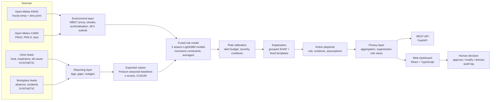
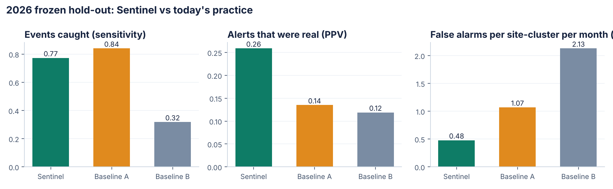
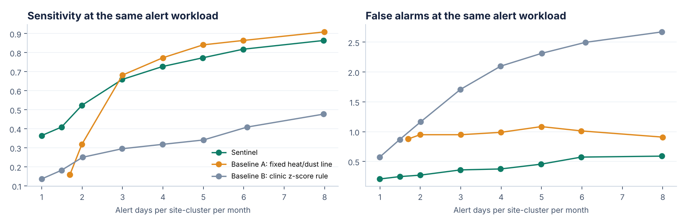

# Sentinel: Technical Documentation

**Explainable 48-hour early warning for heat and dust health risk in outdoor and industrial workforces**

Future Health Digital Innovation Challenge 2026 · Focus area: Population Health · Challenge statement: *Population and Workforce Health Early Warning*

Author: Risny Suha (solo entry) · Version 1.0 · 19 November 2026

| | |
|---|---|
| Live prototype | https://devrisny.github.io/Sentinel-Health-Early-Warning/ |
| Source code | https://github.com/DevRisny/Sentinel-Health-Early-Warning |
| Data status | Weather and dust: **real** (Open-Meteo, CC BY 4.0). Clinic, absence and incident feeds: **synthetic**, from a documented generator. |

---

## 1. Summary

Heat and dust make outdoor and industrial workers ill every summer in the Gulf. Most workplaces still react to one signal: a fixed heat-index line on the weather forecast. That line fires on most summer days, so staff learn to ignore it, and it cannot see the problems that weather alone does not explain, such as a crew of newly arrived, unacclimatised workers or a broken cooling-water supply.

**Sentinel** fuses three kinds of signal for each site cluster and district:

1. **Environmental:** heat stress (hourly WBGT proxy) and dust (PM10, PM2.5) from real reanalysis data, with a 48-hour outlook.
2. **Clinical and service use:** heat-illness, respiratory and all-cause clinic visits.
3. **Workplace:** sickness absence and heat-related incident reports.

It tells a district health team **which** site clusters face a surge in heat- or dust-related illness in the next 48 hours, **why** (in plain sentences built from the data), and **what to do** (a proportionate action card that a named person approves, modifies or dismisses).

**Result on a frozen 2026 hold-out year** (44 health-burden events, 12 site clusters, a year the model never saw):

| | Sentinel | Today's practice: fixed heat/dust line | Clinic z-score rule |
|---|---|---|---|
| Alert days per site per month (workload) | 4.7 | 4.8 | 4.1 |
| **False alarms per site per month** | **0.48** | 1.07 | 2.13 |
| **Alerts that were real (PPV)** | **26%** (95% CI 17–36%) | 14% (8–19%) | 12% (8–16%) |
| Events caught (sensitivity) | 77% (66–89%) | 84% (73–93%) | 32% (18–45%) |
| Ranking quality (average precision, all cluster-days) | **0.24** | 0.12 | 0.07 |
| ROC-AUC | 0.89 | | |

At the same alert workload as the fixed rule, Sentinel **cuts false alarms by 55%** and makes an alert **1.9× as likely to be real**. At lighter workloads (up to 2 alert days per site per month) it also **catches more events** than the fixed rule, and matches it at 3 (Section 7.3). Because the health feeds are synthetic, these numbers show that the method and workflow work; they are not a claim of real-world accuracy.

---

## 2. How Sentinel answers the challenge

| Challenge expectation | How Sentinel meets it | Where to see it |
|---|---|---|
| Fuse clinical/service, environmental and workplace signals | Three signal families, 42 engineered features, one fused model | Data & method page; Section 5 |
| Early warning with lead time | Probability of a burden surge in the next 48 h; warned before onset for 73% of events | Situation page; Trust page |
| Explainable, calibrated alerts | SHAP contributions grouped by signal; fixed-template sentences; Platt-calibrated probabilities with a reliability plot | Alert detail; Trust page |
| Proportionate action, responsible role, evidence, assumptions | Action card per alert with all four, plus Approve / Modify / Dismiss with a logged reason | Alert detail |
| Aggregated data, small-cell suppression | Daily site-cluster counts only; counts 1–4 shown as "<5"; small sites pooled for the regulator | Governance page; API |
| Back-test on historical or simulated scenarios | Real 2024–2026 environment, simulated health feeds with 33 hidden scenarios, frozen 2026 test year | Trust page; Section 7 |
| Measure lead time, sensitivity, false alarms | All reported with bootstrap confidence intervals, against two baselines | Trust page |

**Mapping to the six judging criteria**

| Criterion | Evidence |
|---|---|
| Health impact and clinical relevance | Targets a real, seasonal, preventable burden; actions follow established occupational heat-stress practice; works alongside the UAE midday-break rule |
| Technical depth and architecture | Real reanalysis data pipeline; Poisson seasonal baselines; CUSUM; monotone-constrained gradient boosting; season-wise cross-fitting; calibration; SHAP; fallback model; REST API |
| Working solution and demo quality | Live web app with day-by-day replay, five screens, role switcher, alert-budget slider, dark mode |
| Responsible AI, safety, governance | Aggregate-only data, suppression, role-based views, purpose limit, human approval, audit log, model card, data sheet |
| Scalability and deployment readiness | Config-driven regions and sites; static front end plus stateless API; tested degradation when feeds fail |
| Commercial viability and path to pilot | Section 11: regulator plus employer-cluster pilot, measurable success criteria |

---

## 3. System architecture



| Layer | Implementation | File |
|---|---|---|
| Configuration (region, sites, policy) | Python dataclasses, one file | `sentinel/config.py` |
| Real data fetch | Open-Meteo archive and air-quality APIs | `scripts/fetch_open_meteo.py` |
| Environment features | WBGT proxy, rolling heat, hot-spell streak, hot days so far this year | `sentinel/environment.py` |
| Synthetic health feeds | Documented generator with scenarios and reporting mess | `sentinel/simulate.py` |
| Baselines, features, events | Poisson regression, z-scores, CUSUM, district signals, labels | `sentinel/features.py` |
| Model and policy | LightGBM, Platt scaling, alert budget, baselines A and B | `sentinel/model.py` |
| Explanations and actions | Grouped SHAP, sentence templates, playbook | `sentinel/explain.py` |
| Back-test | Event-level scoring, bootstrap intervals | `sentinel/backtest.py` |
| Orchestration | One command builds everything | `sentinel/pipeline.py` |
| API | FastAPI, role-aware, suppression on the server | `sentinel/api.py` |
| Dashboard | React 19, TypeScript, Tailwind, ECharts, d3-geo | `web/` |
| Tests | pytest: physics, privacy, leakage, API scope | `tests/` |

Run end to end with `python -m sentinel.pipeline` (about 20 seconds on a laptop).

---

## 4. Data and dataset assumptions

### 4.1 Real environmental data

| Item | Detail |
|---|---|
| Weather | Open-Meteo Historical Weather API (ERA5 / ERA5-Land reanalysis): hourly 2 m temperature and dew point; daily max/min temperature, mean humidity, max wind |
| Air quality | Open-Meteo Air Quality API (CAMS global reanalysis): hourly PM10, PM2.5 and dust, aggregated to daily mean and max |
| Places | Five Abu Dhabi districts: Abu Dhabi Island, Mussafah Industrial, KIZAD / Khalifa Port, Al Ain, Al Ruwais (Al Dhafra) |
| Period | 1 January 2024 to 14 November 2026 (1,049 days × 5 districts = 5,245 rows, no gaps) |
| Licence | CC BY 4.0, attribution in the app and here |

**Heat-stress index.** For every hour we compute the Australian Bureau of Meteorology approximation of shade WBGT, `WBGT ≈ 0.567·T + 0.393·e + 3.94`, where `e` is vapour pressure from the dew point, then take the daily maximum. Using temperature and dew point *from the same hour* avoids pairing the afternoon maximum with a morning dew point. The formula ignores solar load and wind and reads high in humid Gulf heat (summer medians around 37), so Sentinel treats it as a **relative index**, never as a compliance reading.

### 4.2 Site clusters (simulated sizes, real places)

Twelve site clusters across five sectors, 650 to 8,800 workers each, with an outdoor-work share from 35% to 90%. Two clusters are below 1,000 workers so that pooling for the regulator view is exercised. Names describe real industrial areas; workforce numbers and characteristics are invented.

### 4.3 Synthetic health and workplace feeds

The organisers provide no data, and real occupational-health records are personal data, so Sentinel drives a generator with the real environment. Every relationship is a simple assumption in the direction reported by published heat-health research, not a fitted clinical model:

| Feed | Generator assumption |
|---|---|
| Heat-illness visits | Rise non-linearly above a WBGT reference of 30 (today and 3-day mean), scaled by outdoor share, site susceptibility and an **acclimatisation factor** that is highest early in the hot season |
| Respiratory visits | Rise with log PM10 above 90 µg/m³, 0–1 day lag, more for outdoor work |
| All-cause visits | Seasonal background plus heat and respiratory visits |
| Sickness absence | Background 2.1% plus heat and dust effects, holiday effects, noise |
| Heat incident reports | Proportional to heat-illness risk, plus scenario effects |
| Work pattern | UAE weekend (Saturday, Sunday), Friday half-shift, Eid holidays (approximate dates) |
| Policy | **UAE midday outdoor-work break** (15 June to 15 September, 12:30–15:00) reduces exposure by 30% |
| Noise | Gamma-Poisson over-dispersion (shape 8) |

**Hidden scenarios.** 33 scenarios add events the weather alone cannot explain: unacclimatised new crews, cooling-water or shade-shelter failures, vulnerable crews in humid heat, Shamal dust surges, and **look-alikes** (vaccination or screening days) that raise all-cause visits and absence but should *not* raise a heat or dust alert. Scenario dates are used only for scoring; the model never sees them.

**Real-world mess.** Reported feeds arrive late (clinic and incidents 1 day, absence 2 days), 2.5% of days are missing at random, and each cluster loses its clinic feed for 5 days once a year. Ground truth is kept separately for scoring only.

### 4.4 What counts as a health-burden event

Burden = heat-illness + respiratory visits summed over a centred 3-day window. An **event day** has a burden rate above the site's 98th percentile in the development years **and** at least 8 visits in the window (so a site of 650 workers cannot trigger an "event" from one or two cases). Event days within 3 days of each other form one event. There are 124 events in total, 44 of them in the 2026 test year.

The model's target: *will an event day occur at this site in the next 48 hours?* The base rate is 3.8% of cluster-days in 2026.

---

## 5. Method

### 5.1 Expected values and deviation scores

For each signal and site, a Poisson regression on the development years learns what is **normal** for the season (two harmonics), weekday and holiday. It deliberately has no weather terms: departures from it are what we want to see. Each reported day becomes a deviation z-score with an over-dispersion factor estimated from training residuals.

### 5.2 Features (all knowable at the end of day *t*)

| Group | Features |
|---|---|
| Heat forecast | Day+1, day+2 and max WBGT (reanalysis plus forecast error of 0.9 and 1.4 °C), heat load = excess × outdoor share × midday-break factor |
| Heat so far | Today's WBGT, 3-day mean, hot-spell length |
| Acclimatisation | Hot days so far this year, midday-break season flag |
| Dust | Today's log PM10, day+1/day+2 forecast with error |
| Heat-illness and respiratory visits | Last reported z-score, 3- and 7-day means, slope, **CUSUM** (k = 0.5), last reported rate, district-wide mean z-score |
| All-cause visits | z-scores (left unconstrained, so a vaccination-day spike is not read as heat) |
| Incident reports, sickness absence | z-scores, CUSUM, rates, at their own reporting lag |
| Site profile, data completeness | Outdoor share, log workforce, share of the last 7 days with clinic data |

### 5.3 Fused risk model

- **LightGBM** gradient-boosted trees (450 trees, 15 leaves, learning rate 0.03, regularised).
- **Monotone constraints** encode domain knowledge: more heat, dust, excess illness, incidents or absence can only *raise* risk. This keeps the model sensible where training examples are scarce.
- **Season-wise cross-fitting.** One model is fitted on 2024 and scores 2025; another is fitted on 2025 and scores 2024. The deployed model averages the two, so deployed scores behave like the out-of-fold scores used for calibration.
- **Calibration.** Platt scaling on the out-of-fold scores, so "20%" means roughly a 1-in-5 chance (reliability plot on the Trust page).
- **Fallback model.** A second model without weather or dust features takes over automatically if the environmental feed is missing, and the dashboard says so.

### 5.4 Alert policy

- **Alert budget.** The alert line is the probability at which the 2025 out-of-fold scores give 3 alert days per site per month on average. This puts alert fatigue under the health authority's control; the dashboard slider lets them try other budgets and see the trade-off live.
- **Severity.** Watch (≥ 8.0%), Warning (≥ 12.0%), Danger (≥ 19.5%), set from the distribution of 2025 alert scores.
- **Cooldown.** Alert days of one site separated by 2 days or fewer count as one alert episode.

### 5.5 Explanations

TreeSHAP contributions (log-odds) are summed into 12 human-readable signal groups and shown as a signed bar chart. A sentence is built from the top three positive groups using **fixed templates** filled with the row's own numbers, for example:

> Risk is elevated mainly because heat stress forecast to reach WBGT 42.0 in the next 48 h (+3.1 above the seasonal normal); also heat has built up: 3-day mean WBGT 40.8 (+1.8 vs normal).

No generative AI is used in the alert path, so the wording cannot invent facts. A phrase is only used when its numbers support it (for example, a visit ratio below 1.15× is never stated as a reason). All-cause visits are never stated as a driver: they guard against look-alikes.

### 5.6 Action playbook

Each alert gets measures matched to its main driver (heat, dust, or an unexplained clinic/incident signal) and severity, a responsible role (site safety officer, occupational-health lead, or the lead plus the regulator duty officer), the evidence sentence, and three explicit assumptions. Modifying or dismissing requires a written reason; every decision is logged with role, time and note.

---

## 6. The prototype

| Screen | What it shows |
|---|---|
| Situation | Map of districts and site clusters coloured by alert level, KPI tiles, alert queue with reasons, 8-week risk timeline, day-by-day replay of 2026, alert-budget slider |
| Alert detail | Risk probability and multiple of usual risk, heat and dust today and forecast, data completeness, "why" panel with signed contributions and evidence (suppressed), 6-week timeline with expected band, optional hindsight replay against the fixed rule, action card with Approve / Modify / Dismiss |
| Trust & validation | Headline comparison, curves at every alert workload, hidden-scenario table, ablation, stress tests, calibration, fairness by site size, full table with confidence intervals |
| Governance | Purpose-limit notice, six safeguards, role matrix, live small-cell suppression, audit log |
| Data & method | Pipeline steps, sources and licences, global feature importance, limitations |

**Roles.** Regulator (districts only, small sites pooled, counts suppressed), occupational-health lead (all sites, all actions), site safety officer (own site only, Watch actions only). A light theme is the default; a dark mode button is in the header.

**Stack.** React 19, TypeScript, Vite, Tailwind CSS 4, Apache ECharts, d3-geo with Natural Earth boundaries; FastAPI for the API. The front end is static, so it can be hosted anywhere (it runs on GitHub Pages).

---

## 7. Validation

### 7.1 Design

- **Development:** 2024 and 2025 (baselines, event thresholds, season-wise cross-fitting, calibration, alert line).
- **Frozen test:** 1 January to 14 November 2026, scored once with thresholds fixed in advance.
- **Units:** whole events (not random days), so a model cannot score well by recognising days inside one long event.
- **Detected** = an alert from 2 days before onset up to the day before the peak (an alert on or after the peak is too late to act on). **Lead time** = peak minus first qualifying alert. An **alert episode** is true if an event day falls between its first day and two days after its last day.
- **Uncertainty:** 2,000 bootstrap resamples of whole events and whole alert episodes.

### 7.2 Headline (operating point: budget 3, set on 2025)

| Measure | Sentinel | Fixed heat/dust rule | Clinic z-score rule |
|---|---|---|---|
| Events | 44 | 44 | 44 |
| Sensitivity | 77.3% [65.9–88.6] | 84.1% [72.7–93.2] | 31.8% [18.2–45.5] |
| PPV | 25.9% [17.3–35.8] | 13.5% [8.4–18.7] | 11.9% [7.9–15.8] |
| False alarms / site / month | **0.48** | 1.07 | 2.13 |
| Alert days / site / month | 4.7 | 4.8 | 4.1 |
| Warned before onset | 72.7% | 84.1% | 22.7% |
| Mean lead time to peak | 57 h | 56 h | 45 h |

Discrimination over all 3,816 test cluster-days: ROC-AUC 0.893, average precision 0.241 (fixed rule 0.122, z-score rule 0.066), Brier score 0.032, base rate 3.8%.

Figure: `reports/figures/headline.png`



### 7.3 Fair comparison at every alert workload

Thresholds for all three methods were set to give the same number of alert days on the test year. At every workload Sentinel produces fewer false alarms than the fixed rule (31% to 80% fewer). At workloads of 1 to 2 alert days per site per month it also catches more events (for example 57% vs 32% at 2 days), it matches the rule at 3 (68% each), and above that, the two converge (84% vs 86% at 6 days).



### 7.4 Hidden scenarios in 2026

| Scenario | Site | Sentinel | Fixed rule |
|---|---|---|---|
| Cooling-water failure | MUS-C1 | 2 days before onset | 1 day before |
| Farm crews, humid heatwave | AAN-C1 | 2 days before | missed |
| Shelter breakdown, industrial park | KZD-C1 | 2 days before | 3 days after onset |
| New crew intake, construction | AAN-C2 | 1 day before | missed |
| Pipeline crews, extreme heat | RUW-C2 | on onset day | 2 days after onset |
| Port crews, heat and humidity | KZD-C2 | 4 days after onset | 1 day before |
| Unacclimatised crew, early heat | AUH-C1 | missed | 1 day before |
| Dust episode, warehousing | MUS-C3 | missed | 2 days before |
| Shamal dust surge | RUW-C1 | missed | missed |
| Late-season heat, workshops | MUS-C2 | missed | missed |
| **Vaccination drive (look-alike)** | MUS-C2 | **correctly silent** | correctly silent |

Sentinel warned earlier than the fixed rule in 5 of 10 real scenarios; the rule was earlier in 3. Dust-driven surges were the weakest scenario type for Sentinel (Section 9).

### 7.5 Ablation: what each signal family adds

| Variant (same workload) | Average precision | Sensitivity | PPV |
|---|---|---|---|
| Environmental only | 0.185 | 68% | 36% |
| + clinic/service data | 0.256 | 68% | 32% |
| + workplace data (full Sentinel) | 0.241 | 68% | 30% |

Clinic data add 38% average precision over weather and dust alone. Workplace feeds add little accuracy in this simulation; they are kept because they keep Sentinel working when the clinic feed fails (below).

### 7.6 Stress tests (model unchanged, inputs degraded)

| Condition | Sensitivity | PPV | False alarms / site / month |
|---|---|---|---|
| Normal operation | 77% | 26% | 0.48 |
| Clinic feed lost (all clinic signals missing) | 80% | 25% | 0.34 |
| Reporting lag +2 days on every feed | 82% | 24% | 0.48 |
| Weather/dust feed lost (fallback model) | 75% | 31% | 0.36 |
| 30% of reported days missing | 75% | 21% | 0.45 |

Sentinel degrades gently and says so: data completeness is shown on every alert, and the fallback model is flagged when it is in use.

### 7.7 Calibration and fairness

Predicted and observed frequencies track each other across deciles (reliability plot on the Trust page and `reports/figures/calibration.png`). Performance is similar for small sites (under 3,000 workers: sensitivity 79%, PPV 29%) and large sites (76%, 23%), so small workplaces are not left behind.

---

## 8. Responsible AI, privacy and governance

| Safeguard | Implementation |
|---|---|
| Aggregate only | Daily counts per site cluster; no names, IDs or individual records anywhere in the pipeline |
| Small-cell suppression | Counts from 1 to 4 are shown as "<5" in the dashboard and replaced on the server by the API |
| Pooling | Sites under 1,000 workers are pooled into their district for the regulator |
| Role-based views | Regulator, occupational-health lead, site safety officer; enforced in the API (HTTP 403 outside scope) |
| Purpose limit | Written in the app and here: no use for individual employment, discipline, insurance or immigration decisions |
| Human in the loop | Sentinel recommends; a named role approves, modifies or dismisses; reasons required for modify/dismiss |
| Audit | Every decision logged with role, time, site, severity and reason |
| Honest uncertainty | Calibrated probabilities, multiple of usual risk, data completeness, fallback flag |
| Alert fatigue | Alert budget, severity levels, cooldown |
| No generative text in alerts | Fixed templates filled with data |
| Transparency | Model card, data sheet, open code, synthetic data labelled on every screen |
| Security | No secrets in the repository; read-only API serving aggregates |

Note on the public demo: because it is a static site, the demo ships the synthetic aggregated counts to the browser and applies suppression on screen. In a deployment the browser would call the API, which applies suppression and role scope before any data leave the server (already implemented and tested in `sentinel/api.py` and `tests/`).

---

## 9. Clinical boundaries, assumptions, dependencies and limitations

**Clinical boundaries**

- Sentinel is a **population-level early-warning and planning aid**. It is not a medical device, does not diagnose, triage or predict risk for any individual, and does not replace clinical judgement, first aid or emergency services.
- Actions are preventive workplace measures (scheduling, rest, water, shade, respirators, field verification) based on common occupational heat-stress practice; local regulations and clinical protocols take precedence.
- Any person with heat-illness symptoms must be treated as a medical emergency regardless of what Sentinel shows.

**Assumptions**

- Clinic, absence and incident counts can be shared daily as site-cluster aggregates with the lags modelled here.
- Heat and dust relationships follow the directions in the literature; the sizes in the generator are illustrative.
- 48-hour weather and dust forecasts of similar quality to those modelled (reanalysis plus error) are available.

**Dependencies**

- Open-Meteo APIs (or any provider of hourly temperature, dew point and PM10) for the environment.
- Python 3.10+ (numpy, pandas, scikit-learn, LightGBM, SHAP, FastAPI); Node 20+ for building the dashboard.

**Limitations (stated plainly)**

1. **Health feeds are synthetic.** Results prove the method and the workflow, not real-world accuracy. A pilot on real aggregated data is the essential next step.
2. **The WBGT value is a proxy** from temperature and humidity; it ignores sun and wind and reads high in humid heat.
3. **Forecasts are simulated** from reanalysis with added error, not archived operational forecasts.
4. **Dust-driven respiratory surges** were the hardest scenario type; a dedicated dust model with longer lags is planned.
5. **Threshold drift.** The alert line was set on 2025; 2026 ran hotter, so the realised workload (4.7 alert days per site per month) exceeded the budget of 3. Thresholds should be reviewed each season, which the budget slider supports.
6. **Development transparency.** During development we inspected test-year scenario traces to confirm that the simulated scenarios produced a detectable signal, and we adjusted the generator. Model thresholds and the final evaluation were fixed before the scored run, but readers should treat the results as a demonstration on simulated data.
7. The demo covers one region. The engine is config-driven, but a second region has not yet been tested.

---

## 10. Deployment and scalability

- **New region or sites:** edit `sentinel/config.py` (districts, site clusters, policy dates), run `scripts/fetch_open_meteo.py` and `python -m sentinel.pipeline`. No code changes.
- **New signals:** add a column to the reported feed and one line to the feature-group map; the model, explanations and dashboard pick it up.
- **Run cost:** the full pipeline (data to dashboard) runs in about 20 seconds on a laptop CPU; scoring one day for 12 sites takes milliseconds. Daily batch is enough for a 48-hour warning.
- **API:** `uvicorn sentinel.api:app` exposes `/health`, `/alerts?date=&role=`, `/clusters/{code}/timeline` and `/validation`.
- **Hosting:** the dashboard is static files (GitHub Pages today); the API is a stateless container. Both fit in any government or employer cloud.

---

## 11. Path to pilot and commercial viability

**Pilot (12 weeks, before and during one summer)**

1. Partners: one public-health authority and one employer cluster (for example an industrial zone operator with on-site clinics).
2. Data agreement for daily site-cluster aggregates only: heat-illness and respiratory visits, sickness absence, incident reports.
3. Weeks 1–4: connect feeds, refit baselines, run silently alongside current practice.
4. Weeks 5–12: live alerts to occupational-health leads, with decisions logged.
5. Success criteria: at least 30% fewer false alarms than the current heat rule at equal workload; median warning at least 24 hours before onset; 90% of alerts acted on or dismissed with a reason within 24 hours; zero privacy incidents.

**Business model.** Annual subscription per monitored workforce for employers and zone operators, and a regional licence for public-health authorities, with the regulator view included so that employers and the authority work from the same picture. Benefits that pay for it: fewer heat-illness cases and lost workdays, fewer ignored alerts, and evidence of due diligence for heat-safety regulation.

---

## 12. Reproducibility

```bash
pip install -r requirements.txt
python scripts/fetch_open_meteo.py      # optional: data/raw/open_meteo_daily.csv is included
python -m sentinel.pipeline             # model, back-test, figures, dashboard data
pytest                                  # 11 tests
cd web && npm install && npm run dev    # dashboard on http://localhost:5173
uvicorn sentinel.api:app --reload       # API on http://localhost:8000/docs
```

All random steps use fixed seeds; the pipeline reproduces the numbers in this document exactly.

---

## 13. References

1. Australian Bureau of Meteorology. *About the WBGT and Apparent Temperature indices* (approximation of shade WBGT from temperature and humidity).
2. ISO 7243:2017. *Ergonomics of the thermal environment: Assessment of heat stress using the WBGT index.*
3. Hersbach H. et al. (2020). The ERA5 global reanalysis. *Quarterly Journal of the Royal Meteorological Society* 146: 1999–2049.
4. Copernicus Atmosphere Monitoring Service (CAMS) global atmospheric composition reanalysis and forecasts.
5. Zippenfenig P. Open-Meteo.com Weather API. CC BY 4.0.
6. Flouris A.D. et al. (2018). Workers' health and productivity under occupational heat strain: a systematic review and meta-analysis. *The Lancet Planetary Health* 2(12): e521–e531.
7. Gasparrini A. et al. (2015). Mortality risk attributable to high and low ambient temperature: a multicountry observational study. *The Lancet* 386: 369–375.
8. Farrington C.P. et al. (1996). A statistical algorithm for the early detection of outbreaks of infectious disease. *JRSS Series A* 159: 547–563.
9. Page E.S. (1954). Continuous inspection schemes. *Biometrika* 41: 100–115.
10. Ke G. et al. (2017). LightGBM: A highly efficient gradient boosting decision tree. *NeurIPS*.
11. Lundberg S.M., Lee S.-I. (2017). A unified approach to interpreting model predictions. *NeurIPS*.
12. Platt J. (1999). Probabilistic outputs for support vector machines and comparisons to regularized likelihood methods.
13. UAE Ministry of Human Resources and Emiratisation. Annual midday break for outdoor work (15 June to 15 September, 12:30–15:00).

See also: [MODEL_CARD.md](MODEL_CARD.md) · [DATA_SHEET.md](DATA_SHEET.md)
